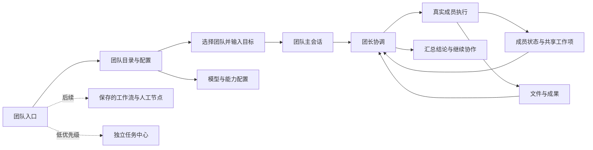

# CrewON 二开需求方案 v0.3

本方案于 2026-11-04 编制，状态为待评审。用户已确认参考同级 cuican-aide，并将 Agent Team 设为高优先级，独立任务功能设为低优先级、可以暂缓。首版围绕团队定义、协作执行、成员贡献和会话恢复形成可用闭环。团队模式的先后顺序、视觉资源和持久工作流范围仍按第 9 节评审。

三种模式的场景、生命周期、两套参考实现的取舍及内置插件落地顺序，详见 [协作模式设计](team-modes-design.md)。

## 1. 产品目标

用户在团队入口选择或配置一组 Agent，给出目标和资料，由团长协调实际成员执行。用户能看到当前分工、成员进度、来源明确的结果，以及需要自己决策的事项。中途离开后能重新找到同一团队会话、成员记录和产物。

核心验收路径为“选择团队 → 输入目标 → 团长分工 → 成员执行 → 汇总成果 → 继续协作”。功能来源和底座差异详见 [功能对照](aide-feature-map.md)。该对照基于本次静态源码核对，原工程页面的运行效果在实施相应功能时重新确认。

“独立任务功能”在本方案中指全局任务列表、关注/已读管理、任务筛选与任务中心。团队运行所需的内部工作项、状态和依赖属于 Agent Team 的高优先级范围。基础 Session 会话与历史继续使用 DSH 的现有能力。

## 2. 范围与优先级

| 阶段 | 功能范围 | 交付结果 |
|---|---|---|
| P0 Agent Team | F02 团队目标、F18 专家团，增加团队定义/成员面板/共享工作项，复用 F04、F07、F08、F10、F12、F22 的必要能力 | 用户选择真实团队，成员执行可见，团长汇总成果，停止与重开行为明确 |
| P1 协作深化 | F16 办公室、F17 持久工作流、F20 中的执行恢复 | 保存流程、人工确认、独立验证和重启后的原执行恢复 |
| P2 体验与能力扩展 | F01 三场景首页、F03 导航完善、F06 搜索、F11 浏览器、F13 知识、F14 助理、F15 日程、F19 插件体验 | 团队工作更易发现、复用和检查成果 |
| P3 独立任务与业务 | F05 全局任务中心及已读/筛选，F09 的通用任务详情增强，F21 业务插件，F22 的多用户账号和远程设备 | 另行排期的完整任务管理和业务能力 |

P0 使用已有 DSH Session、preset、subagent、agent-team、模型、权限和产物服务。新增团队配置与协作 UI 通过插件和 slot 组合。P0 的工作台只接入已有文件/产物显示，完整首页重设计和独立任务中心进入后续阶段。

## 3. 信息架构

高优先级入口为团队目录、团队会话、成员与分工、成果及必要设置。桌面和宽屏 Web 采用左侧团队/会话导航、中间主会话、右侧成员与成果。窄屏将右侧内容切为抽屉或页签，输入和停止始终可达。

首版在现有 DSH 界面中提供团队入口和会话扩展。基础资源配置、模型和权限继续可达。团队成员详情与成果视图按需展开，保留主会话的阅读空间。

### 统一产品术语

| 用户概念 | 含义与对应记录 |
|---|---|
| 团队定义 | 团队名称、类型、团长、成员及各自能力配置，可保存复用 |
| 团队会话 | 某次目标的顶层 Session，引用本次采用的团队配置版本 |
| 团队工作项 | 团队内部的分工、owner、状态和依赖，复用原生 agent-team 基础 |
| Agent | 可配置角色，实际执行由 preset 与 subagent 承接 |
| 专家团 | 团长对外汇总，后台专家分别执行与提供来源 |
| 办公室 | 持续讨论同一目标，允许 @成员并由组长协调 |
| 工作流 | 保存的步骤定义及对应执行记录，包含人工节点和验证节点 |
| 独立任务中心 | 跨会话的任务列表、关注状态和筛选，为后置功能 |

## 4. P0 Agent Team 需求

### R16 团队定义与原生协作基础

团队目录支持创建、编辑、复制和归档团队。每个团队包含名称、说明、模式、团长、成员、职责、模型及能力选择。成员引用真实可用的 Agent/preset，保存时校验引用、重复成员和缺失能力。并发数及执行预算有明确配置与校验。

团队配置保存后可重新打开。启动团队会话时记录所用配置版本，后续编辑用于新的协作执行。已有会话的成员身份和历史结果保持原关联。归档团队保留其历史会话入口。

在发起页展示团队目标、当前工作空间和资料。团队来源于用户明确选择，切换场景保留团队。提交失败保留目标、附件与成员选择，重复提交受去重约束。

团队工作项复用原生 agent-team 的 owner、状态和依赖。界面展示待分配、执行中、等待依赖、等待用户、完成和失败的来源，状态从实际记录投影。团长可以分配独立工作给多个成员，并在汇总前确认所需结果已返回。

验收要求为保存并重新打开一个三成员团队，启动后出现真实成员 Session/执行记录，成员权限与所选能力一致。缺失成员或能力时给出明确修复入口，禁止显示虚构的执行进度。

### R11 专家团协作

专家团由一个团长承接用户对话，后台专家按职责提供调查、执行或审阅结果。主会话展示团长结论，并能展开每位专家的独立贡献、来源、状态和产物。团长汇总引用成员结果，明确未完成或失败的部分。

成员可以按依赖并行或顺序执行。某成员失败时，团长将失败作为明确输入处理，用户可以选择重试该成员、调整目标或停止。成员重试记录新的尝试，保留前次结果。已完成的独立成员工作保持可查。

验收使用“方案比较与复核”案例，配置调研、分析、验证三个角色。每位成员必须产生可追溯的结果，验证者检查前面成员的结论，团长汇总其差异与限制。界面能区分成员自己的贡献和团长总结。

### R12 办公室协作（P1）

办公室围绕同一工作目标持续讨论。用户可 @一个成员，也可将消息交给组长安排。消息显示真实作者，点击成员查看职责与当前工作。@一个成员的请求只发送给相应对象，组长分发形成明确的交接记录。

共享上下文由宿主管理，成员获取与职责相关的目标、资料和必要交接内容。团队配置规定成员工具权限与写入范围。潜在冲突的写操作通过执行策略协调，独立读取按许可并行。

验收使用“整理材料 → 分析问题 → 审阅结论”的接力案例。成员身份、交接、上下文来源和文件结果可查。用户继续讨论时沿用同一办公室关系，页面刷新后能还原成员顺序与已有结果。

### R17 团队控制、恢复与成果

用户能查看整体协作状态和每位成员状态。等待权限、等待用户回答、等待成员依赖和模型失败分别显示。停止团队时停止新的分发，并按各成员实际取消结果展示后续状态。成员结束后清理其运行资源，同时保留持久历史与产物。

页面断线重连后恢复同一团队会话和已提交结果。Host 重启后按已保存记录区分已完成、可继续和已中断的执行。恢复入口沿用原执行身份，查询结果未知的外部操作时先核对原操作。

右侧面板提供成员、共享工作项和成果页签。成果引用实际文件或结构化结果，并带作者与所属工作项。团队整体完成时，团长给出完成范围、成果入口、剩余事项和验证结果。

验收覆盖成员运行中关闭页面、刷新、Host 重启、单成员失败和用户停止。每种情况的最终状态与实际执行一致，重新打开后已提交成员结果和作者保持一致。

### P0 所需配套

P0 从 R02 复用工作空间与资料选择，从 R03 复用团队目标、模型与权限，从 R05 复用主会话流式反馈，从 R06 复用成果预览，从 R07 复用基础设置，从 R08 提供成员所需资源配置。各项完整产品增强按下一节排期。

### R13 持久工作流（P1）

工作流保存 Agent、人工确认和独立验证节点，用户查看节点输入、状态、输出和当前等待点。人工节点的批准或拒绝作用于原执行版本，决策保留审阅内容与结果。节点执行继续使用已有 Agent 与工具服务。

当前 DSH workflow 文档列明缺少检查点、重启续跑和保存的工作流。R13 因此需要独立设计流程定义、节点执行记录、人工决策及恢复协调。已提交外部操作的恢复先核对原回执，新的执行尝试需要明确身份与去重规则。

验收要求为在人工节点暂停后刷新页面并重启 Host，仍能看到原输入与待决策节点。批准或拒绝后按该决策继续，已完成节点的结果保持可查。

## 5. 配套与后置功能需求

### R01 品牌与工作首页（P2）

采用 CrewON 名称、标识和统一主题。首页保留中性的任务入口，使用日常办公、代码、创意设计三个场景。每个场景有对应的说明、输入提示、快捷任务和资源建议。快捷任务将内容放入可编辑草稿，用户发送后创建任务。

场景切换保留已选工作空间、执行目标、模型、附件与用户输入。场景负责组织任务意图和推荐资源，执行目标负责选择 Agent。两者在状态与接口上独立保存。

验收要求为三个场景至少各有两个可用快捷入口，切换后上述选择保持一致。首页、侧栏、设置和空会话使用同一品牌，深浅主题与资源图标清晰可见。品牌颜色和标识资源需要用户确认。

### R02 工作空间与上下文（P0 最小配套）

全局“新建任务”打开独立草稿，允许选择“默认执行环境”或已有工作空间。从某个工作空间创建任务时预选该空间。用户在发送前能辨认实际执行位置，创建后的分组按 Session 的真实归属显示。

`+` 菜单按文件/文件夹、Skill、MCP 和后续知识资源分组。工作空间另有独立选择器。已添加资源以可删除的引用显示。移除引用只修改当前草稿中的选择。新任务创建失败时保留文本和引用。

验收要求为在两个工作空间分别发起任务，执行路径和历史分组始终匹配。默认执行环境的任务创建成功后显示实际归属。资源无法访问时展示具体原因，并支持移除或重新选择。

### R03 输入框、模型与执行意图（P0 团队输入配套，其他增强 P2）

输入框采用紧凑布局，直接提供发送、停止、资源添加、模型、权限、执行目标和可选 Goal/Plan 操作。团队入口创建的草稿绑定所选团队，原有单 Agent 入口保留对应目标。目标选择器显示真实配置与可用状态，失效目标保留草稿并给出修复入口。

Goal 与 Plan 的草稿选择互斥，发送后清理本次草稿意图。正在执行的持久 Goal 另有明确状态。用户从活跃 Goal 切到 Plan 时，先说明现有目标将如何处理，再通过服务执行所选操作。Plan 的权限控制沿用独立 sandbox 与 approval 设置。

`+`、`@`、`/` 弹层均支持 Escape、选择后关闭、再次点击触发器关闭和点击外部关闭。Enter/换行规则在设置中可查，组合输入期间保持中文输入正常。

验收要求为双击发送只产生一个新任务提交，失败草稿可继续编辑。切换模型或权限的结果能在实际请求记录中核对。页面显示与 Host 拒绝结果保持一致。

### R04 任务列表（P3）与全局搜索（P2）

任务列表支持工作空间过滤、近期任务和需要关注的任务。需要人工操作、失败待处理、完成未读优先于普通历史。查看结果可以改变已读状态，执行状态继续由持久记录决定。个人/团队筛选随独立任务页后置，团队本身的工作项仍在团队面板中管理。

搜索增强按 P2 排期，目标覆盖工作空间、会话标题和可用的历史内容检索。文件搜索明确限定选中的工作空间，并显示查询来源和加载状态。结果支持方向键、Enter、Escape，关闭后恢复触发位置的焦点。

验收要求为从搜索结果打开原任务后，工作空间、会话与结果保持一致。历史索引未启用或读取失败时显示可操作的状态。零结果使用正常空态，搜索结果按来源区分。

### R05 主会话与执行反馈（P0 团队配套）

主会话展示流式回复、工具调用、当前步骤、权限请求、错误和最终产物。用户可以停止执行、补充消息、回到历史任务继续。任务进行中与等待用户操作需要不同的视觉状态。

运行步骤、长期目标和 Plan 方案各有清楚标签。文件变更与产物只引用对应执行的真实记录。文件操作异常、模型失败和用户取消保留各自的原因及后续入口。

验收要求为页面刷新和断线恢复后，历史内容、工具结果与最终状态一致。失败任务不会显示成功徽标，停止完成后输入恢复可用。任务详情在没有对应数据时隐藏空栏目。

### R06 右侧工作台与产物检查（P0 复用已有能力，重设计 P2）

工作台承载文件树、文档/图像预览、终端、任务改动和插件结果。点击消息中的文件引用定位到同一文件，切换 tab 保留必要的查看位置。关闭 tab 与清理任务的动作分别定义。

首版优先复用 DSH 已有预览格式与终端服务。网页 tab 按 Web/Desktop 的实际承载能力提供。无法嵌入时保留在系统浏览器打开的入口。预览、Agent 浏览器操作与后续录制功能分别管理。

验收要求为完成一次代码修改后能查看对应 diff，完成一次文档生成后能打开实际文件。连续切换两个任务时，文件、终端与产物的所属任务清楚可见。430px 宽和 900×460 低高度下主要操作可达。

### R07 模型、权限与基础设置（P0 复用已有能力）

设置提供模型配置、连接状态、外观、语言、执行权限和插件入口。模型配置使用已有 provider 与凭据服务。保存失败保留输入并显示具体原因，保存后从实际选项中选择可用模型。

验收要求为至少一个已配置模型完成文本与工具任务，停止、错误反馈和重开会话均可观察。权限请求说明操作对象与影响，用户选择后仅作用于对应请求或明确范围。

### 后续资源与业务需求

| 需求 | 优先级 | 用户行为与结果 | 关键验收 |
|---|---|---|---|
| R08 资源中心 | P0 最小团队配置，完整目录 P2 | 为成员配置 Agent、Skill、MCP，后续扩展统一目录 | 真实成员能力可用，安装、启用和执行状态清楚 |
| R09 助理与日程 | P2 | 固定助理会话和一次性/重复安排 | 时区、下次运行、暂停和重启恢复准确 |
| R10 插件页面 | P2 | 安装 DSH 格式插件，进入配置及页面 | 安装、禁用、升级与历史查看可用 |
| R14 知识资源 | P2 | 管理来源与记忆，检索可追溯引用 | 来源更新和权限撤销后结果一致 |
| R15 业务插件 | P3 | 以短剧为候选样板，关联对话与成果 | 同一业务项目的内容版本和采用关系一致 |

## 6. 技术落点与数据责任

| 责任 | 建议落点 | 开发约束 |
|---|---|---|
| CrewON 外观、导航、首页 | 独立 Client 插件与主题配置 | 复用 slot、ui-primitives、locale、CSS Modules 与语义 token |
| 任务与状态聚合 | Session 查询、projection、必要的已读状态存储 | 执行事实由日志和服务产生，页面只提交明确用户动作 |
| 工作空间、文件、终端与产物 | 现有 Workspace、FS、terminal、deliverables 服务 | 读取与操作携带实际归属，遵守已有权限 |
| Agent、模型与资源 | preset、LLM、skill、MCP、plugin manager | 保持对应服务的配置、生命周期与错误处理 |
| 调度 | schedule 服务与新的日历 UI | 保存时区与目标，展示真实运行回执 |
| 团队与工作流 | 新的产品服务组合既有 subagent/team/workflow 能力 | 定义持久对象和恢复，区分用户目标与成员内部执行 |
| 业务成果 | 业务插件自己的版本化对象 | Session 保存协作事实，业务对象保存内容版本与采用关系 |

新增用户偏好与业务定义可以采用 storage 服务。需要回放的执行事实进入 Session 事件与投影。具体持久类型与公开接口在对应需求设计时声明，并按仓库要求评审兼容性。旧 cuican-aide 数据迁入需要先枚举导出格式、所有者和版本，本方案建议首版新建任务使用 DSH 数据。

## 7. 分批交付与退出条件

| 批次 | 开发范围 | 本批通过条件 |
|---|---|---|
| M0 团队设计 | 确认团队定义、成员配置、模式与状态，完成 DSH 能力验证 | 确定 P0 对象与配置，验证真实成员启动、通信、工作项与取消 |
| M1 Agent Team 可用版 | R16、R11、R17 及必要会话/资源配套 | 三成员专家团实际执行、汇总、查看成员贡献、失败恢复和重开通过 |
| M2 持久工作流 | R13，复用已验证的 DAG 并补充节点持久化 | 人工节点、验证节点、Host 重启与原执行恢复通过 |
| M3 办公室 | R12，完善长期成员、话题、@成员与交接 | 明确点名与组长协调均可用，持续讨论和成员归属可恢复 |
| M4 体验扩展 | 完整首页、搜索、知识、日程、插件体验 | 按独立需求验收，不作为 M1 的启动依赖 |
| M5 后置能力 | 独立任务中心、通用任务管理增强及业务插件 | 重新确认需求后排期 |

M1 组成建议首个可用版本，M2、M3 按协作模式设计推进。专家团先行是本方案的实施建议，用户已确认的是 Agent Team 整体高优先级。估时在 M0 明确团队模式和持久恢复边界后给出。独立任务中心保持低优先级。

## 8. 团队验收场景

| 场景 | 优先级 | 操作与必须观察的结果 |
|---|---|---|
| AT01 团队配置 | P0 | 创建三成员团队，保存、重开、编辑和归档，历史会话仍引用原配置 |
| AT02 真实分工 | P0 | 团长分发调研/分析/审阅工作，每个成员有实际执行记录和独立结果 |
| AT03 并行与依赖 | P0 | 两个独立工作并行，验证工作等待所需输入，汇总使用已返回结果 |
| AT04 成员可见性 | P0 | 主会话保持清晰，展开成员面板查看真实作者、工具、工作项和产物 |
| AT05 失败与重试 | P0 | 一个成员失败后显示原因，重试产生新尝试，其他已完成结果保留 |
| AT06 团队停止 | P0 | 用户停止后终止新的分发，每个在途成员显示真实取消或结束结果 |
| AT07 页面恢复 | P0 | 执行中刷新及断线重连，恢复同一会话、成员、分工和已提交结果 |
| AT08 Host 重启 | P0 | 显示中断与已完成执行，恢复沿用原身份，未知操作先查回执 |
| AT09 权限与工作空间 | P0 | 两个团队使用不同工作空间，成员读写与授权范围保持正确 |
| AT10 办公室点名 | P1/M3 | @指定成员形成对应回复，组长交接显示真实作者与上下文 |
| AT11 持久人工节点 | P1/M2 | 人工节点等待时重启，重开原审阅内容，决策后从原节点继续 |
| AT12 团队界面 | P0 | 键盘、窄屏、低高度均能输入、查看成员、停止和打开成果 |

UI 改动执行仓库要求的 GUI 检查和对应 Web replay。团队逻辑通过真实组合、keyless Session 快照及必要真实 API 验收，检查实际成员调用与产物。Web 目录选择器使用 root AGENTS 指定 overlay，Desktop 覆盖实际原生交互。文档检查与实现验收分别记录。

## 9. 待评审的三个实现选择

| 决定 | 建议 | 对范围的影响 |
|---|---|---|
| Agent Team 首个模式 | 专家团 → 工作流 → 长期办公室 | 先验证分发与汇总，再补持久节点和长期协作 |
| 首版持久性 | 团队定义与成员历史持久化，Host 重启后明确恢复/中断状态 | 先完成可追溯协作，工作流逐节点自动续跑在 M2 单独验收 |
| 界面实施范围 | 现有 DSH 增加团队入口、成员面板和成果页签 | 三场景首页、完整搜索和独立任务中心后置 |

已确定的优先级为 Agent Team 高、独立任务功能低。M1/M2 的模式先后与首版恢复深度为本方案建议，评审时可调整。
